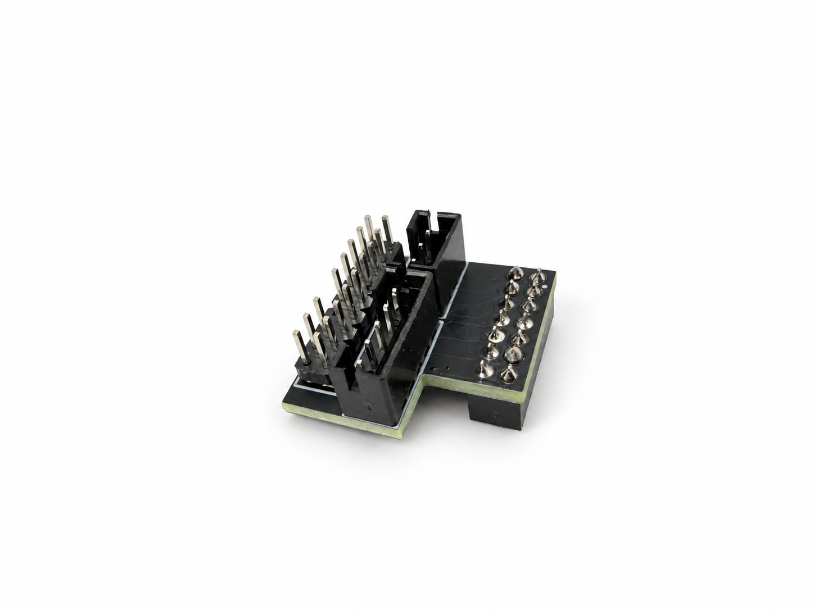

# Thunderbolt-USB4-AIC-GPIO-Adapter-Design
This design enables support for Thunderbolt 4, USB4, and Thunderbolt 5 add-in cards from MSI and Gigabyte on ASUS motherboards. Please be sure to consult the instructions in the Readme regarding actual compatibility and usability.

  

## Before You Begin

Before installing a Thunderbolt or USB4 add-in card, **update your motherboard BIOS to the latest version**. Early BIOS releases for many motherboards lack the configuration menus required for Thunderbolt and USB4 support.

## Add-in Card Compatibility

In theory, if your motherboard **explicitly supports a particular add-in card from its own manufacturer**, this adapter should allow you to use an equivalent card from another manufacturer.

For example, if you have an **ASUS motherboard with an Intel 500-, 600-, or 700-series chipset** that is explicitly listed as compatible with the [**ASUS ThunderboltEX 4**](https://www.asus.com/tw/motherboards-components/motherboards/accessories/thunderboltex-4/helpdesk_compatibility?model2Name=ThunderboltEX-4), you should theoretically be able to use this adapter with an **MSI ThunderboltM4** or a **Gigabyte Maple Ridge** add-in card.

## Tested Compatibility

The following add-in cards have been tested with the [**ROG STRIX Z890-A GAMING WIFI S**](https://rog.asus.com.cn/motherboards/rog-strix/rog-strix-z890-a-gaming-wifi-s/) motherboard:

| Add-in Card (AIC) | USB4 / Thunderbolt 5 Functionality | DisplayPort Alt Mode Output | USB Power Delivery (PD) Charging |
| --- | --- | --- | --- |
| [**MSI USB4 PD100W Expansion Card**](https://www.msi.com/PC-Component/USB4-PD100W-EXPANSION-CARD/support) | USB4 works normally | Works normally | Does not work |
| [**Gigabyte THUNDERBOLTS 5**](https://www.gigabyte.com/PC-Accessory/THUNDERBOLTS-5) | Thunderbolt 5 works normally | Works normally | Does not work |

> [!WARNING]
> **USB Power Delivery (PD) charging does not work with either tested add-in card in this configuration**, although USB4 / Thunderbolt 5 functionality and DisplayPort Alt Mode output work normally.

We will look for a solution to this issue in a future update.

## Manufacturer-Specific Limitations

Compatibility depends on the motherboard manufacturer's implementation:

- **Gigabyte:** Gigabyte motherboards lack the GPIO support required for USB4 add-in cards, so this adapter cannot enable their use. Some models offer onboard USB4 instead.
- **MSI:** Thunderbolt 5 add-in card support is problematic. The **JTBT5 GPIO** implementation on MSI 800-series motherboards has compatibility issues even with the **ThunderboltM5** card bundled with the GODLIKE motherboard.
- **ASRock:** Current Thunderbolt 4 support has limitations and requires **manually configuring jumpers on the add-in card**. ASRock has not yet released a Thunderbolt 5 add-in card.

## Adapter Design and Untested Configurations

These limitations are why I have only made adapters for **using other manufacturers' add-in cards with ASUS motherboards**.

In theory, you could reverse the connections in the open-source design to use add-in cards from other manufacturers with Gigabyte or MSI motherboards. However, we have **not tested compatibility** with these configurations.

> [!CAUTION]
> We have **not tested** Thunderbolt or USB4 add-in cards on AMD motherboards, and we are not optimistic about compatibility.
>
> Proceed with caution if you attempt to use this adapter with an AMD motherboard.
